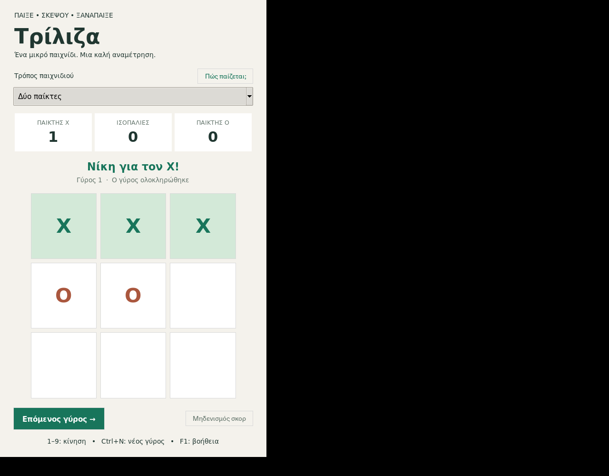

# Τρίλιζα · 1.3.3

Εφαρμογή για υπολογιστή και κινητό με ελληνικό περιβάλλον. Δύο παίκτες στην ίδια συσκευή
ή αντίπαλος με τέσσερα επίπεδα: εύκολο, μέτριο, δύσκολο και αήττητο.
Ανίχνευση νίκης και ισοπαλίας,
επισήμανση νικηφόρας τριάδας, σκορ συνεδρίας και εναλλαγή πρώτου παίκτη.
Λειτουργεί offline, χωρίς λογαριασμούς, διαφημίσεις ή τηλεμετρία.
Σκούρο περιβάλλον με πλευρικό μενού, στρογγυλεμένα πλακίδια, προεπισκόπηση
κίνησης, κινούμενα σύμβολα και ευδιάκριτη ένδειξη νικηφόρας τριάδας.
Δεν απαιτούνται πρόσθετα πακέτα για τα γραφικά.
Σύντομοι ήχοι στα κουμπιά, στις κινήσεις X/O, στη νίκη και στην ισοπαλία.
Όταν κερδίζει ο υπολογιστής, ακούγεται ξεχωριστός, χαμηλός ήχος ήττας.
Το κουμπί «Ήχος» πάνω δεξιά ή το F2 ενεργοποιεί/απενεργοποιεί τους ήχους.



## Εγκατάσταση Windows — χωρίς Python

1. Άνοιξε τις [εκδόσεις του παιχνιδιού](https://github.com/NaelCh/Tic-Tac-Toe-GUI/releases/latest).
2. Από τα Assets κατέβασε το `Triliza-1.3.3-Windows-Setup.exe`.
3. Άνοιξε τον εγκαταστάτη και επίλεξε Install.
4. Παίξε από τη συντόμευση «Τρίλιζα» στο μενού Έναρξη.

Στέλνεις **μόνο το αρχείο Setup.exe** στον παραλήπτη. Περιλαμβάνει το παιχνίδι,
Python/Tk, εικονίδιο και ήχους· ο παραλήπτης δεν εγκαθιστά εργαλεία ανάπτυξης.
Εγκαθίσταται για τον τρέχοντα χρήστη, χωρίς δικαιώματα διαχειριστή.
Υποστηρίζει Windows 10/11 με x64. Περιλαμβάνει απεγκατάσταση από τις εφαρμογές
των Windows και προαιρετική συντόμευση στην επιφάνεια εργασίας.
Για Windows 7 SP1 x64 υπάρχει ξεχωριστή δοκιμαστική [έκδοση Legacy](LEGACY.md).
Ο παραπάνω εγκαταστάτης προορίζεται για Windows 10/11.

Ο εγκαταστάτης δεν είναι ψηφιακά υπογεγραμμένος. Για επαγγελματική διανομή,
η υπογραφή κώδικα απαιτεί πιστοποιητικό του εκδότη.

### Αναβάθμιση υπάρχουσας εγκατάστασης

Κλείσε το παιχνίδι και εκτέλεσε τον νέο εγκαταστάτη με τον ίδιο λογαριασμό
Windows. **Δεν χρειάζεται προηγούμενη απεγκατάσταση**: αναγνωρίζει τον υπάρχοντα
φάκελο και ενημερώνει την ίδια εφαρμογή και τις συντομεύσεις της. Ο ίδιος
εγκαταστάτης λειτουργεί και σε υπολογιστή όπου δεν υπήρχε το παιχνίδι.

Για το μέγεθος και τον τρόπο διανομής αυτής της εφαρμογής, ο πλήρης εγκαταστάτης
είναι απλούστερος από ένα ξεχωριστό patch που απαιτεί συγκεκριμένη παλιά έκδοση.
Δεν υπάρχει ακόμη αυτόματο κατέβασμα ή εγκατάσταση ενημερώσεων μέσα στο παιχνίδι.

## Κινητό — Android και iPhone

Άνοιξε την [έκδοση κινητού](https://naelch.github.io/Tic-Tac-Toe-GUI/) στον browser.
Παίζει με αφή, με φίλο στην ίδια συσκευή ή με τα τέσσερα επίπεδα υπολογιστή.
Περιλαμβάνει ήχους και αποθηκεύει την επιλογή αντιπάλου και ήχου στη συσκευή.
Τα σκορ ισχύουν για την τρέχουσα συνεδρία.

- **Android / Chrome:** πάτησε «Εγκατάσταση» ή το μενού ⋮ →
  «Εγκατάσταση εφαρμογής» / «Προσθήκη στην αρχική οθόνη».
- **iPhone / Safari:** πάτησε Κοινοποίηση → «Προσθήκη στην οθόνη Αφετηρίας».

Μετά την πρώτη φόρτωση και την ένδειξη **«Έτοιμο για offline»**, μπορείς να παίξεις
και χωρίς σύνδεση από το εικονίδιο. Δεν χρειάζεται Python, APK ή λογαριασμός.
Οι ενημερώσεις εμφανίζονται με κουμπί μέσα στην εφαρμογή ώστε να ολοκληρώσεις
πρώτα την παρτίδα σου. Ο φίλος παίζει στην ίδια συσκευή· δεν περιλαμβάνεται
ακόμη παιχνίδι από απόσταση.

Ο πηγαίος κώδικας και οι οδηγίες ανάπτυξης βρίσκονται στον [φάκελο web](web/README.md).
Η έκδοση κινητού δημοσιεύεται από το [Mobile web app workflow](.github/workflows/mobile.yml)
μόνο μετά τους ελέγχους μηχανής, αφής, διάταξης και offline λειτουργίας στον browser.
Οι αυτοματοποιημένοι έλεγχοι χρησιμοποιούν Chrome με διαστάσεις κινητού·
η εγκατάσταση σε πραγματικό iPhone/Android χρειάζεται δοκιμή στη συσκευή.

## Εκκίνηση από τον κώδικα — για ανάπτυξη

Χρειάζεται Python 3.10+ με Tkinter και γραφικό περιβάλλον:

```sh
python main.py
```

Στο συγκεκριμένο cloud περιβάλλον χρησιμοποίησε `/usr/bin/python3 main.py`.
Η προεγκατεστημένη εναλλακτική Python/Tk 9 δεν αποδίδει σωστά τα ελληνικά.
Σε Debian/Ubuntu τα πακέτα `python3-tk` και `fonts-dejavu-core` παρέχουν Tk και γραμματοσειρά.
Δεν χρειάζονται πακέτα pip για το παιχνίδι.

## Επίπεδα δυσκολίας

| Επίπεδο | Συμπεριφορά |
| --- | --- |
| Εύκολο | Επιλέγει τυχαία ένα ελεύθερο κελί. |
| Μέτριο | Παίρνει τις άμεσες νίκες. Αναγνωρίζει μια άμεση απειλή με πιθανότητα 65%, αλλιώς επιλέγει τυχαία. Αφήνει περισσότερες ευκαιρίες στον παίκτη. |
| Δύσκολο | Παίρνει τις άμεσες νίκες, αναγνωρίζει απειλές με πιθανότητα 88% και παίζει βέλτιστα στο 60% των υπόλοιπων αποφάσεων. Οι άλλες κινήσεις είναι τυχαίες, οπότε μπορεί να χάσει και από απλή απειλή ή παγίδα. |
| Αήττητο | Επιλέγει πάντα βέλτιστη κίνηση. Δεν χάνει, είτε ξεκινά πρώτο είτε δεύτερο. |

Μέτριο και δύσκολο μπορούν να νικηθούν με σωστό παιχνίδι. Μια τυχαία κίνηση
μπορεί να αποδειχθεί σωστή κατά τύχη· τα ποσοστά δεν εγγυώνται νίκη σε κάθε
παρτίδα. Η ίδια στρατηγική ισχύει και όταν ξεκινά ο υπολογιστής.

## Χρήση

- Επίλεξε φίλο ή υπολογιστή από το πλευρικό μενού και μετά επίπεδο δυσκολίας.
  Με υπολογιστή παίζεις πάντα X.
- Κάνε κλικ σε κελί ή χρησιμοποίησε την αρίθμηση του αριθμητικού πληκτρολογίου
  (Num Lock ενεργό). Λειτουργούν επίσης τα ψηφία της επάνω σειράς πλήκτρων:

  ```text
  7  8  9
  4  5  6
  1  2  3
  ```

  Το 7 αντιστοιχεί στο πάνω αριστερό κελί, το 5 στο κέντρο και το 3 στο κάτω δεξί.
- Τρία ίδια σύμβολα στη σειρά, στήλη ή διαγώνιο κερδίζουν.
- Το «Επόμενος γύρος» εναλλάσσει τον πρώτο παίκτη. Ctrl+N κάνει το ίδιο.
- F1 εμφανίζει βοήθεια. Tab και Space/Enter επιτρέπουν χειρισμό κουμπιών.
- F2 ή το κουμπί «Ήχος» ενεργοποιεί/σιγάζει τους ήχους χωρίς επανεκκίνηση.
- Αλλαγή τρόπου παιχνιδιού μηδενίζει τα σκορ με επιβεβαίωση.
- Τα σκορ δεν αποθηκεύονται όταν κλείσεις την εφαρμογή.

## Έλεγχοι

```sh
python -m unittest discover -s tests -p test_engine.py -v
python -m unittest discover -s tests -p test_difficulty.py -v
python -m unittest discover -s tests -v
```

Ο πλήρης έλεγχος χρειάζεται οθόνη. Σε headless Linux:

```sh
xvfb-run -a python -m unittest discover -s tests -v
```

Ελέγχονται όλοι οι τύποι νίκης, η ισοπαλία, μη έγκυρες κινήσεις, το σκορ,
το Reset, οι εναλλαγές γύρων, η ακύρωση εκκρεμούς κίνησης και η αλλαγή αντιπάλου.
Τα ενδιάμεσα επίπεδα ελέγχονται για άμεσες νίκες, άμυνα και ευκαιρίες ήττας,
και όλα τα επίπεδα για νόμιμες κινήσεις χωρίς αλλαγή του αρχικού ταμπλό.
Το αήττητο AI ελέγχεται απέναντι σε κάθε δυνατή ακολουθία ανθρώπινων κινήσεων,
τόσο όταν ξεκινά πρώτο όσο και δεύτερο.

## Δημιουργία πακέτου

Το workflow [Windows installer](.github/workflows/release.yml) χτίζει το
εκτελέσιμο σε Windows, δημιουργεί εγκαταστάτη με Inno Setup 6, κάνει πραγματική
εγκατάσταση, εκκινεί το εγκατεστημένο παιχνίδι με Python εκτός PATH και ελέγχει
νικηφόρα παρτίδα, Reset και ενσωματωμένους ήχους. Απεγκαθιστά το παιχνίδι και
δημοσιεύει το Setup.exe και SHA256 μόνο εφόσον ολοκληρωθούν οι έλεγχοι.
Ελέγχει επίσης αναβάθμιση από την 1.3.1 χωρίς απεγκατάσταση και νικηφόρα
παρτίδα με συμβάντα αριθμητικού πληκτρολογίου στο εγκατεστημένο εκτελέσιμο.

Για επόμενη έκδοση, άλλαξε το `VERSION`, κάνε commit/push και δημιούργησε το
αντίστοιχο tag, π.χ. `v1.3.3`. Το tag πρέπει να συμφωνεί ακριβώς με το VERSION.
Χειροκίνητη εκτέλεση από το Actions δημιουργεί downloadable artifact χωρίς Release.

Στο λειτουργικό σύστημα προορισμού, με Python/Tkinter:

```sh
python -m venv .venv
# Linux/macOS:
.venv/bin/python -m pip install -r requirements-build.txt
.venv/bin/python tools/build.py
# Windows, αντί για τις δύο παραπάνω εντολές:
.venv\Scripts\python -m pip install -r requirements-build.txt
.venv\Scripts\python tools\build.py
# Windows: μετά το build, με Inno Setup 6:
ISCC.exe /DAppVersion=1.3.3 installer\windows.iss
```

Παραδίδεις ολόκληρο τον φάκελο `dist/Triliza`, μαζί με το `_internal`.
Στο Linux εκκινείς `./Triliza`, στα Windows `Triliza.exe`.
Το macOS δημιουργεί επίσης `dist/Triliza.app`. Απαιτείται ξεχωριστή δοκιμή,
συμπερίληψη οδηγιών/γνωστοποιήσεων και υπογραφή πριν διανεμηθεί το app bundle.
Ο τελικός χρήστης δεν χρειάζεται να εγκαταστήσει Python.
Δεν γίνεται cross-compilation: Windows πακέτα χτίζονται σε Windows.
Το Linux πακέτο αυτού του περιβάλλοντος χτίστηκε σε Debian 13, x86_64/glibc 2.41.
Παλαιότερες διανομές δεν θεωρούνται συμβατές χωρίς ξεχωριστό build και δοκιμή.

Οι ήχοι χρησιμοποιούν το ενσωματωμένο `winsound` στα Windows και το `afplay`
στο macOS. Στο Linux χρειάζεται διαθέσιμο `paplay` ή `aplay`. Αν δεν υπάρχει
συσκευή ή διαθέσιμος player, το παιχνίδι συνεχίζει κανονικά χωρίς ήχο.

Δες το [THIRD_PARTY.md](THIRD_PARTY.md) για τις άδειες εξαρτήσεων.
